# EU Energy Lakehouse (REE Market Prices)
[](https://github.com/Daniel-GH12/eu-energy-lakehouse/actions/workflows/ci.yml)
## Problema de negocio y solución

El mercado eléctrico español publica precios con **granularidad mixta** (tarifa regulada **PVPC** horaria frente a mercado mayorista **Spot** cuartohorario cada 15 min) y marca temporal en hora local con cambios de horario (CET/CEST).  
Este proyecto implementa un **Lakehouse Medallion (Bronze → Silver → Gold)** reproducible, validado con contratos de datos y preparado para ejecutarse tanto en local como *serverless* en AWS.  
Entrega tablas analíticas listas para negocio que miden cada hora el **spread PVPC vs. Spot (`pvpc_spot_spread_eur_mwh`)** y la **volatilidad intrahoraria de los intervalos de 15 minutos (`spot_intraday_range_eur_mwh`)**.

## Arquitectura

```mermaid
flowchart LR
    REE["REE API<br/>(Precios PVPC 1h + Spot 15m)"] --> EB["AWS EventBridge<br/>(cron 06:00 UTC)"]
    EB --> LAMBDA["AWS Lambda (Docker)<br/>energy_lakehouse.pipeline"]
    LAMBDA --> BRONZE["S3 Bronze / local<br/>raw.json (particionado date=YYYY-MM-DD)"]
    BRONZE --> PANDERA["Pandera Data Contract<br/>(UTC, sin nulos, [-500, 4000] EUR/MWh)"]
    PANDERA --> SILVER["S3 Silver / local<br/>prices.parquet (Hive partitioning)"]
    SILVER --> DBT["DuckDB + dbt-core<br/>(stg_ree_prices -> mart_hourly_price_spread)"]
    DBT --> GOLD["Capa Gold<br/>Tabla analítica + 5 data tests"]
```



## Quickstart

### 1. Ejecución en local

```powershell
python -m venv .venv
.\.venv\Scripts\Activate.ps1
pip install -e ".[dev]"

# Ejecutar el pipeline completo (Bronze -> Silver -> Gold) para una fecha concreta
python -m energy_lakehouse.pipeline --date 2025-11-01
```

*(Si omites `--date`, procesa automáticamente el día de ayer. Para subir Bronze y Silver a AWS S3, configura `S3_BUCKET` siguiendo `.env.example`).*

### 2. Ejecución con Docker

```powershell
docker build -t eu-energy-lakehouse .
docker run --rm -v "${PWD}/data:/app/data" eu-energy-lakehouse --date 2025-11-01
```

### 3. Tests y calidad de código

```powershell
ruff check .
pytest -v
dbt test --project-dir dbt --profiles-dir dbt
```

## Decisiones de Arquitectura y Trade-offs (ADRs)

| Decisión | Alternativa descartada | Justificación técnica y de negocio |
| --- | --- | --- |
| **DuckDB + dbt-core** | Redshift / Snowflake | Coste **0 € en reposo**, ejecución embebida en `< 1 s` para volúmenes diarios/mensuales y linaje + tests SQL declarativos sin mantener un clúster siempre encendido. |
| **AWS Lambda (Docker) + EventBridge** | Airflow / AWS MWAA | Evita pagar **~300 €/mes** por un orquestador activo 24/7 para un *batch* diario de pocos segundos; pago estricto por ejecución. |
| **Parquet + Hive partitioning (`date=YYYY-MM-DD`)** | RDS PostgreSQL | Compresión columnar, *partition pruning* directo sobre S3 con DuckDB y separación total entre almacenamiento y cómputo sin administrar instancias ni backups de BD. |

## Estimación FinOps (AWS `eu-west-1`)

Infraestructura definida como código en `infra/` con presupuesto mensual estricto en AWS Budgets (`5 USD`, alerta al `80 %`) y permisos IAM de mínimo privilegio.

| Servicio AWS | Uso estimado mensual (job diario) | Coste estimado / mes |
| --- | --- | --- |
| **AWS Lambda** (1024 MB, ~15 s/día) | ~450 GB-s/mes (dentro de *Free Tier* permanente) | `0.00 €` |
| **Amazon EventBridge** (1 regla cron diaria) | ~30 invocaciones/mes | `0.00 €` |
| **Amazon S3** (Bronze JSON + Silver Parquet) | < 100 MB/año + ~60 PUT/mes | `< 0.05 €` |
| **Amazon ECR** (1 imagen Docker ~400 MB) | Almacenamiento de imagen de contenedor | `~0.04 €` |
| **CloudWatch Logs** (retención básica) | Logs de ejecución diarios | `< 0.10 €` |
| **Total estimado** | **Pipeline productivo completo** | **`< 2.00 €/mes`** (típico `< 0.25 €/mes`) |

Para eliminar por completo todos los recursos desplegados y evitar cualquier coste residual:

```powershell
terraform -chdir=infra destroy
```
